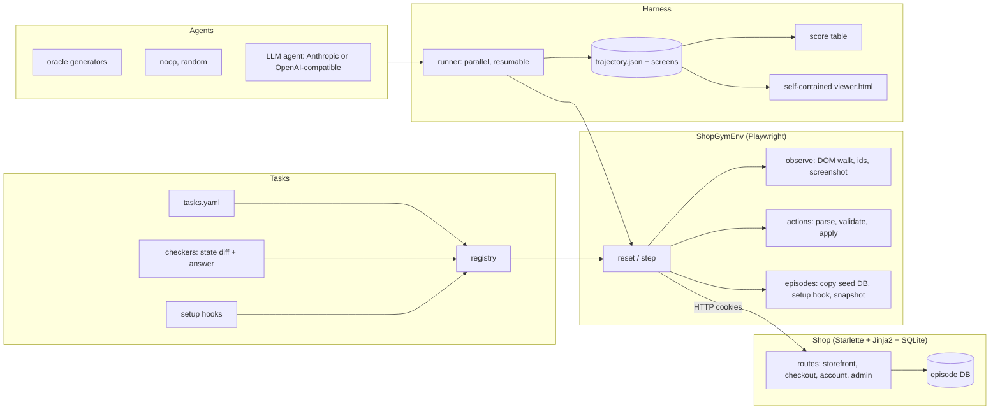

# ShopGym: a computer-use evaluation environment for browser agents

ShopGym is a self-hosted online shop (storefront, customer accounts, checkout, and an admin panel) plus
a Gymnasium-style environment that lets an agent act on it through screenshots, a text view of the page
with stable element ids, and browser actions. It ships 27 tasks. Each task has a checker that reads
the database state and the agent's answer, and that also penalises unrelated side effects. Every task
has a scripted oracle that solves it through the UI, and two baselines (no-op and random) that must score
zero. The whole loop runs headless with no API keys.

## What is hard about this, and how it is solved

- **The site has to be hard, not just big.** The shop has multi-step checkout with validation (Luhn card
  check, expiry, postcode), pagination on catalogue and reviews, filters, modal confirmations, address
  book defaults, and admin order state machines. Tasks need real traversal and disambiguation: two
  customer accounts share a name, the "most recent" order is not the first one listed, and the cheapest
  garden item is out of stock.
- **Checkers must not trust the trajectory.** Each checker compares a snapshot of the database taken
  after task setup with the live database at the end, and the agent's answer. `assert_only` fails any
  row changed outside the allowance, so cancelling the wrong order fails even when the right one was
  cancelled too. Checkers compute ground truth from the snapshot (for example with the same
  `search_products` query the storefront uses), so the expected answers are never hard-coded.
- **Episodes must be reproducible and parallel.** The seed generator is deterministic (same seed, same
  bytes; password salts come from the email, and the clock is fixed). Each episode copies its own
  database, and the browser's `sg_episode` cookie routes requests to that file. Four episodes running at
  once cannot see each other's carts (tested).
- **Element ids must be stable.** A DOM walker tags visible interactive elements in document order
  (`e1`, `e2`, ...), so the same page state gives the same ids. Actions are validated before they touch the
  browser: element ids, URL paths (same site only), key names and scroll amounts.
- **Every task has to be provably solvable.** The oracle is a generator script that resolves elements by
  role and name on the latest observation. It reads like a user, and a test runs all 27 through the
  browser.

## Architecture



Layout:

| Path | Role |
| --- | --- |
| `src/shopgym/app/` | the shop: routes by area, templates, SQLite schema, deterministic seed, catalogue query |
| `src/shopgym/env/` | environment: observations, action space, episode isolation, `ShopGymEnv` |
| `src/shopgym/tasks/` | `tasks.yaml` (27 tasks), checkers, setup hooks, registry |
| `src/shopgym/agents/` | oracle controller and scripts, baselines, LLM agent and providers |
| `src/shopgym/harness/` | parallel resumable runner, score report, HTML viewer |
| `tests/` | app flows, seed, actions, checkers, browser e2e, LLM loop, harness |

## Quickstart

Keyless demo first. It needs Python 3.12 and uv, and it boots the shop itself on port 4200:

```bash
make install     # uv sync + Chromium for Playwright
make demo        # oracle + noop + random, all 27 tasks, headless
```

`make demo` prints the score table and writes `runs/demo/viewer.html`, which is one self-contained file.
Open it in a browser to step through any episode.

Other commands:

```bash
make test                      # all tests (about 1 minute; browser tests included)
make test-fast                 # everything except the browser tests (about 25 seconds)
uv run shopgym serve           # run the shop on http://127.0.0.1:4200 and browse it
uv run shopgym tasks           # list tasks
uv run shopgym report runs/demo
uv run shopgym view runs/demo --out viewer.html
```

With a real model (not run in this environment; see below):

```bash
cp .env.example .env           # add ANTHROPIC_API_KEY, or set SHOPGYM_PROVIDER=openai and SHOPGYM_BASE_URL
set -a; . ./.env; set +a
uv run shopgym serve &
uv run shopgym run --agents llm --mode screenshot --tasks newsletter-subscribe,cancel-order-1042 --run-dir runs/llm
```

`--mode text` sends the element list only. `--mode screenshot` also sends the page image. Runs resume:
episodes with a `result.json` on disk are skipped unless you pass `--force`.

## Design decisions and trade-offs

- **Server-rendered HTML, no SPA.** Every control is a real form or link, so the observation is the
  accessibility-relevant truth, and the agent cannot act on state the user could not see. JavaScript is
  limited to dialogs.
- **One server, many episodes.** Isolation is by cookie and database file, not by process. This keeps
  the port budget (4200 to 4209) and startup cost small. The trade-off is that the server opens a new
  SQLite connection per request, which is fine at this scale and would not survive heavy write load.
- **Checkers are declarative.** A checker is a function plus parameters from `tasks.yaml`. The oracle reads
  the same parameters, so the instruction, the checker and the oracle cannot drift apart silently.
- **Oracles are privileged on purpose.** An oracle may read the seed database to find an answer. It proves
  solvability, not agent skill. The UI path still has to work, and the tests check that.
- **Stdlib password hashing.** PBKDF2 from `hashlib`, no extra dependency.
- **Two tiers of anchors.** Named entities (orders 1042 to 1062, four named customers, a Trail Runner Pro
  with 13 reviews) are fixed, so tasks can refer to them. Everything else is random from the seed.
- **Trajectories keep PNG screenshots on disk.** The viewer downsizes them to JPEG and embeds them, so the
  HTML is self-contained. A demo run is about 100 MB on disk and the viewer about 27 MB.

## Verification

- `make test`: 146 tests, all passing. Line coverage of `src/` is 86%.
- Per-task: every checker fails a no-op, and each task's oracle passes (`test_oracle_solves_every_task`).
  Deliberate wrong actions fail: cancelling order 1043 instead of 1042, refunding the other Hedy Lamarr's
  order, a cart with the wrong quantity, and an unrelated write in the newsletter task.
- Determinism: the same seed gives the same observation text, element table and screenshot bytes, and
  the same seeded database file bytes.
- Isolation: four parallel episodes each add a different product, and each database holds only its own.

## Limitations and next steps

- **Live-model runs are not verified.** The LLM agent and its Anthropic and OpenAI-compatible providers
  are covered by tests with a scripted provider. No live model was called from this project, because the
  machine has no API keys. The first real run should be a few tasks, with the result checked by hand.
- **No visual grounding for coordinates.** Clicks by pixel exist, but the random agent is the only
  baseline that uses them, and no task requires them.
- **The shop is English-only, with one currency** (USD labels, UK addresses), and checkout takes test cards only.
- **Tasks are about 27, not thousands.** Adding a task means adding a `tasks.yaml` entry, a checker if the
  existing ones do not fit, and an oracle. The tests would catch a missing piece.
- **Multi-tab and back-button recovery are only lightly exercised.** `back` is in the action space, but no
  task depends on it.
- **Next:** a pass-rate sweep over several seeds (the `--seeds` flag already exists), a wrong-action
  oracle per task so the sabotage tests are generated rather than hand-written, and running the viewer
  against an LLM run for a side-by-side comparison.
